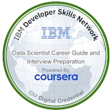
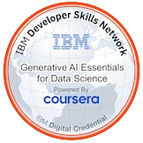
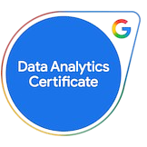
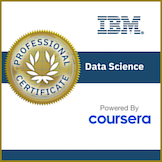
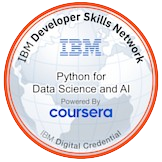

# Hi 👋, I'm Muhammad Mujtaba Uz Zaman

### A passionate Machine Learning Engineer & Data Science enthusiast from Karachi, Pakistan 🇵🇰

  

- 🔭 I'm currently working on **Machine Learning & Deep Learning Applications**
- 🌱 I'm currently learning **Advanced Machine Learning & Deep Learning (CNNs, Transfer Learning, Model Optimization)**
- 👨‍💻 All of my projects and live demos are available at **[Explore My Projects](YOUR_LIVE_DEMO_LINK)**
- 💬 Ask me about **Python, Machine Learning, Deep Learning, Data Analysis, TensorFlow & Scikit-learn**
- 📫 How to reach me: **mujtabazaman.work@gmail.com**
- 💼 Connect with me: [LinkedIn](https://linkedin.com/in/mujtaba-uz-zaman)
- 📄 Know about my experience: <a href="./Mujtaba_Zaman_CV.pdf" target="_blank">View My Resume</a>

### Languages and Tools:

**Currently Working With – Machine Learning & Data Science**

Python / SQL / Pandas / NumPy / Matplotlib / Seaborn / Plotly / Scikit-learn / TensorFlow / Keras / CNN / EfficientNet-B0 / Power BI / Excel / Jupyter Notebook

**Previously Worked With – Web Development & Other Technologies**

HTML / CSS / Bootstrap / JavaScript / React Native / Firebase / MongoDB / MySQL / Git / GitHub / VS Code

<h2 align="left">🏆 Professional Badges</h2>
<table align="center">
  <tr>
    <td align="center">
      
       <strong>Applied Data Science Capstone</strong>
    </td>
    <td align="center">
      
       <strong>Data Analysis with Python</strong>
    </td>
    <td align="center">
      
       <strong>Data Scientist Career Guide and Interview Preparation</strong>
    </td>
    <td align="center">
      
       <strong>Data Visualization with Python</strong>
    </td>
  </tr>
  <tr>
    <td align="center">
      
       <strong>Generative AI Essentials for Data Science</strong>
    </td>
    <td align="center">
      
       <strong>Google Data Analytics Professional Certificate</strong>
    </td>
    <td align="center">
      
       <strong>IBM Data Science Professional Certificate</strong>
    </td>
    <td align="center">
      
       <strong>Python for Data Science and AI</strong>
    </td>
  </tr>
</table>

