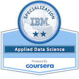
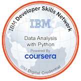
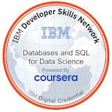
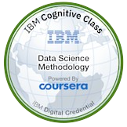
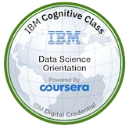
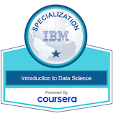
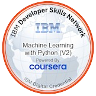
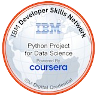
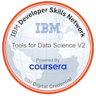

# Hi 👋, I'm Muhammad Mujtaba Uz Zaman

### A passionate Machine Learning Engineer & Data Science enthusiast from Karachi, Pakistan 🇵🇰

  

- 🔭 I'm currently working on **Machine Learning & Deep Learning Applications**
- 🌱 I'm currently learning **Advanced Machine Learning & Deep Learning (CNNs, Transfer Learning, Model Optimization)**
- 👨‍💻 All of my projects and live demos are available at **[Explore My Projects](YOUR_LIVE_DEMO_LINK)**
- 💬 Ask me about **Python, Machine Learning, Deep Learning, Data Analysis, TensorFlow & Scikit-learn**
- 📫 How to reach me: **mujtabazaman.work@gmail.com**
- 💼 Connect with me: [LinkedIn](https://linkedin.com/in/mujtaba-uz-zaman)
- 📄 Know about my experience: <a href="./Mujtaba_Zaman_CV.pdf" target="_blank">View My Resume</a>

### Languages and Tools:

**Currently Working With – Machine Learning & Data Science**

Python / SQL / Pandas / NumPy / Matplotlib / Seaborn / Plotly / Scikit-learn / TensorFlow / Keras / CNN / EfficientNet-B0 / Power BI / Excel / Jupyter Notebook

**Previously Worked With – Web Development & Other Technologies**

HTML / CSS / Bootstrap / JavaScript / React Native / Firebase / MongoDB / MySQL / Git / GitHub / VS Code

<h2 align="left">🏆 Professional Badge & Achievements</h2>

  <strong>16 Verified Badges</strong> &nbsp; | &nbsp;
  <strong>IBM</strong> &nbsp; | &nbsp;
  <strong>Google</strong>

<table align="center">
  <tr>
    <td align="center" width="25%">
      
       <strong>Applied Data Science Capstone</strong>
       <a href="https://www.credly.com/badges/3d1dd368-7e71-418c-8e92-839223897584/public_url">View Credential ↗</a>
    </td>
    <td align="center" width="25%">
      
       <strong>Applied Data Science Specialization (V3)</strong>
       <a href="https://www.credly.com/badges/fa964707-b830-455e-849d-0281aa80a2b6/public_url">View Credential ↗</a>
    </td>
    <td align="center" width="25%">
      
       <strong>Data Analysis with Python</strong>
       <a href="https://www.credly.com/badges/5e452a2d-4c4d-4e76-b521-314eed3272c9/public_url">View Credential ↗</a>
    </td>
    <td align="center" width="25%">
      
       <strong>Databases and SQL for Data Science</strong>
       <a href="https://www.credly.com/badges/afa7cf9c-45a2-4ec3-b06c-1880d5eb6699/public_url">View Credential ↗</a>
    </td>
  </tr>

  <tr>
    <td align="center" width="25%">
      
       <strong>Data Science Methodology</strong>
       <a href="https://www.credly.com/badges/990fa834-71f9-450d-a1aa-842a736ca765/public_url">View Credential ↗</a>
    </td>
    <td align="center" width="25%">
      
       <strong>Data Science Orientation</strong>
       <a href="https://www.credly.com/badges/1aa144a2-6e27-4969-ae7f-b798c62c9cab/public_url">View Credential ↗</a>
    </td>
    <td align="center" width="25%">
      
       <strong>Data Scientist Career Guide & Interview Preparation</strong>
       <a href="https://www.credly.com/badges/230fe295-5164-42ee-8766-0e7ea93995d6/public_url">View Credential ↗</a>
    </td>
    <td align="center" width="25%">
      
       <strong>Data Visualization with Python</strong>
       <a href="https://www.credly.com/badges/30d151b2-9f6f-4564-8276-b4d645173cd3/public_url">View Credential ↗</a>
    </td>
  </tr>

  <tr>
    <td align="center" width="25%">
      
       <strong>Generative AI Essentials for Data Science</strong>
       <a href="https://www.credly.com/badges/c71f8daa-be55-4b95-9aa4-5c0c5a5a9c08/public_url">View Credential ↗</a>
    </td>
    <td align="center" width="25%">
      
       <strong>Google Data Analytics Professional Certificate</strong>
       <a href="https://www.credly.com/badges/93b262b8-94eb-4e64-986b-ddbfae957efa/public_url">View Credential ↗</a>
    </td>
    <td align="center" width="25%">
      
       <strong>IBM Data Science Professional Certificate (V3)</strong>
       <a href="https://www.credly.com/badges/38292e86-cbb9-405a-aa52-77d0b36180d9/public_url">View Credential ↗</a>
    </td>
    <td align="center" width="25%">
      
       <strong>Introduction to Data Science Specialization (V2)</strong>
       <a href="https://www.credly.com/badges/9bee4cdb-aded-4f81-b9f2-0318e71c7606/public_url">View Credential ↗</a>
    </td>
  </tr>

  <tr>
    <td align="center" width="25%">
      
       <strong>Machine Learning with Python (V2)</strong>
       <a href="https://www.credly.com/badges/dbc4e794-f703-4549-9cc5-8080207539a4/public_url">View Credential ↗</a>
    </td>
    <td align="center" width="25%">
      
       <strong>Python for Data Science and AI</strong>
       <a href="https://www.credly.com/badges/bbb9c4a9-db90-4525-8f1c-e7c37f122784/public_url">View Credential ↗</a>
    </td>
    <td align="center" width="25%">
      
       <strong>Python Project for Data Science</strong>
       <a href="https://www.credly.com/badges/a75e2cc9-531f-4727-92df-91da3d3e85a5/public_url">View Credential ↗</a>
    </td>
    <td align="center" width="25%">
      
       <strong>Tools for Data Science (V2)</strong>
       <a href="https://www.credly.com/badges/7b224d0d-2634-4f22-8843-672f552cd483/public_url">View Credential ↗</a>
    </td>
  </tr>
</table>

  <i>Committed to continuous learning and professional growth in Data Science and AI.</i>

